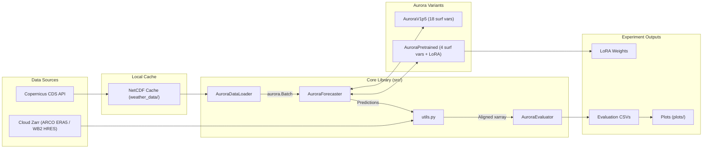

# Project Overview

Amirim is a weather forecasting research codebase for running experiments on Microsoft's Aurora
Earth foundation model. The project investigates Aurora's capabilities across multiple domains,
including spatial context scaling (global vs. regional bounding-box inference), evaluation on
extreme weather phenomena (heatwaves, heavy precipitation, atmospheric rivers, and total column
water vapor), resource benchmarking, and parameter-efficient LoRA fine-tuning on ERA5 reanalysis
data to improve forecast performance.

## Repository Structure

* `src/` – Core reusable library modules for ERA5 data loading (`dataloader.py`), model inference
  and rollouts (`forecaster.py`), forecast verification (`evaluator.py`), and shared utilities
  (`utils.py`).
* `scripts/` – Executable experiment, fine-tuning, resource benchmarking, and plotting scripts,
  including `extreme_scripts/` for extreme weather evaluations.
* `docs/` – Scientific specifications of evaluation metrics, curated extreme event catalogs, and
  project documentation.
* `plots/` – Generated figures and comparative charts organized by experiment type.
* `weather_data/` – Local cache directory for downloaded ERA5 NetCDF files (gitignored).
* `scratch/` – Temporary workspace for ad-hoc test runs, caches, and exploratory plots.

## Build & Development Commands

Install dependencies:
```bash
pip install torch xarray cdsapi h5netcdf pandas numpy matplotlib seaborn cartopy
pip install microsoft-aurora extremeweatherbench peft psutil
```

Run primary experiments and evaluations (execute from repository root):
```bash
# Fine-tune the model
python scripts/finetune_aurora_6h.py

# Evaluate pretrained vs finetuned
python scripts/evaluate_pretrained_vs_finetuned.py

# Compare spatial contexts
python scripts/compare_global_vs_med_aurora.py

# Generate plots
python scripts/plot_finetune_comparison.py
```

## Code Style & Conventions

* **Formatting & Naming**: Python 3.10+ with `from __future__ import annotations` and standard type
  hints (`list[int] | None`). Use `PascalCase` for classes (`AuroraDataLoader`), `snake_case` for
  functions and variables, and `UPPER_SNAKE_CASE` for module-level constants.
* **Variable Naming**: Always use ECMWF/Aurora shortNames (`2t`, `10u`, `10v`, `msl`, `q`, `z`)
  internally rather than raw CDS parameter names (`2m_temperature`).
* **Geospatial Constraints**:
  1. Spatial grid dimensions (`H`, `W`) must be multiples of 16 to satisfy Aurora's patch-based
     architecture.
  2. Longitudes must be standardized to `[0, 360)` and strictly increasing.
* **Script Imports**: Scripts in `scripts/` append the project root to `sys.path` before importing
  from `src/`.
* **Lint Config & Commit Message Template**:
  > TODO: Define formal linter configuration (e.g., Ruff/Flake8) and commit-message template.

## Architecture Notes



1. **Data Acquisition (`src/dataloader.py`)**: `AuroraDataLoader` fetches surface and pressure-level
   ERA5 data via the CDS API (either per-sample via `get_batches()` or monthly bulk archives via
   `bulk_download_range()` and `get_batches_from_bulk()`). It isolates NetCDF caches per bounding
   box, maps CDS names to Aurora shortNames, computes solar insolation, and constructs `Batch`
   objects.
2. **Model Inference & Fine-Tuning (`src/forecaster.py` & `scripts/`)**: `AuroraForecaster` wraps
   two distinct model variants:
   * `AuroraV1p5` (`aurora-0.25-v1.5.ckpt`): Uses 18 surface variables for context comparisons and
     extreme weather evaluations.
   * `AuroraPretrained` (`aurora-0.25-pretrained.ckpt`): Uses 4 surface variables (`2t`, `10u`,
     `10v`, `msl`) and supports native LoRA adapters (`use_lora=True`).
   Inference runs in 6-hour autoregressive steps (`predict_step()` / `predict_rollout()`) across
   configurable spatial scopes (`Original`, `Enlarged_Small`, `Enlarged_Large`, `Global`).
3. **Verification & Metrics (`src/utils.py` & `src/evaluator.py`)**: `utils.py` converts predicted
   batches to `xarray.Dataset`, derives integrated atmospheric variables (TCWV, IVT), lazily streams
   cloud ARCO ERA5 and WeatherBench2 HRES Zarr stores, and aligns grids. `AuroraEvaluator` computes
   verification metrics (RMSE, PAE, CBE, IoU, EAR) across lead times and exports tabular results.

## Agent Guardrails

* **Keep `src/` Modular**: Never place experiment-specific dates, hardcoded paths, or plotting logic
  inside `src/`. All experiment workflows belong in `scripts/`.
* **Cache Isolation**: Never share a single `cache_dir` across different spatial bounding boxes or
  resolutions; always instantiate separate `AuroraDataLoader` cache paths per scope to prevent
  NetCDF file collisions.
* **Model Variant Compatibility**: Do not mix `AuroraV1p5` and `AuroraPretrained` variable sets.
  Ensure `pretrained_only=True` in `AuroraDataLoader` (or `filter_batch_for_pretrained()`) when
  working with `AuroraPretrained` or LoRA checkpoints.
* **External Rate Limits & Storage**: Avoid redundant per-sample CDS API queries over long date
  ranges; use `bulk_download_range()` for multi-month datasets and lazy `chunks=None` connections
  when opening remote GCS Zarr stores.
* **Protected Files**: Do not commit or overwrite raw NetCDF caches in `weather_data/`, model
  checkpoints (`.ckpt`, `.pt`), or user credentials (`~/.cdsapirc`).

## Implementation & Review Rules for Agents

After formulating a code implementation plan, keep the following rules in mind:

1. **No Redundant Imports**: Do not introduce unused, duplicate, or redundant imports.
2. **Memory & GPU Efficiency**: Be mindful of RAM and GPU memory usage; minimize memory footprint
   (e.g., moving tensors to CPU when done, freeing intermediate objects) as long as it does not
   alter behavior or sacrifice code readability and simplicity.
3. **Bug & Deprecation Check**: Review all written code to ensure correctness and verify that no
   bugs or deprecated APIs/lines exist.
4. **Accuracy & Edge Cases**: Walk through the written code to confirm it solves the task
   accurately and accounts for all relevant edge cases (e.g., `NaN` values, empty slices, grid
   alignment boundaries).
5. **Ask Before Major Decisions**: If an essential design or implementation decision arises that
   materially affects the outcome, ask the user for clarification before proceeding.

## Further Reading

* [Project README](README.md)
* [Extreme Weather Evaluation Metrics](docs/extreme_evaluation_metrics.md)
* [Extreme Precipitation Cases Catalog](docs/extreme_precipitation_cases.md)

