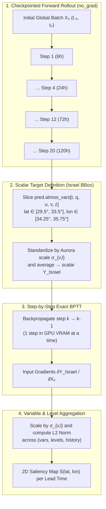
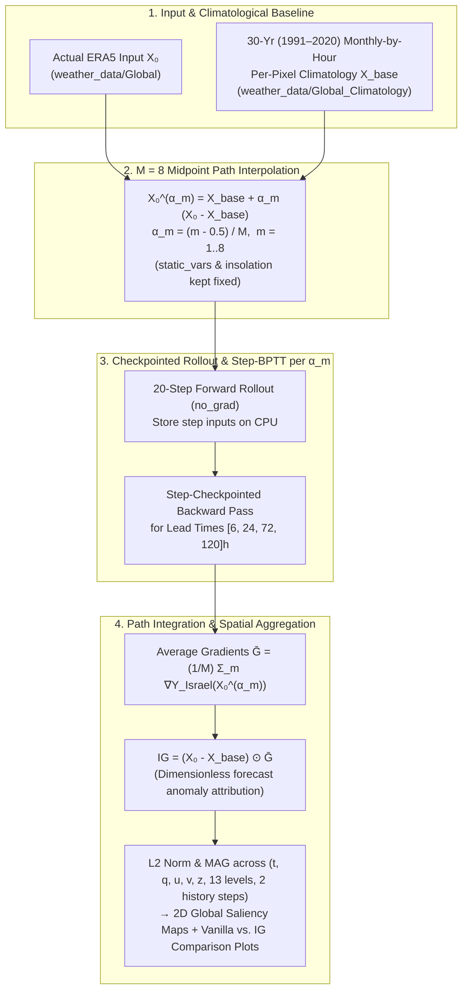

# Gradient-Based Saliency & Integrated Gradients (IG) for Weather Prediction in Israel (Aurora 0.25°)

> **Scope**: Spatial feature attribution on Microsoft's **Aurora 0.25° (`AuroraV1p5`)** global foundation model to quantify how important every global coordinate pixel `(lat, lon)` is for predicting the atmospheric state over **Israel** across lead times of **6, 24, 72, and 120 hours**.
>
> **Target Variables**: All 5 Aurora atmospheric variables (`t` temperature, `q` specific humidity, `u` eastward wind, `v` northward wind, `z` geopotential) across all 13 standard pressure levels (`50` to `1000` hPa).
>
> **Target Region (`ISRAEL_BBOX`)**: `lat ∈ [29.5°N, 33.5°N]`, `lon ∈ [34.25°E, 35.75°E]` ($17 \times 7$ grid points on the $0.25^\circ$ global grid).
>
> **Scripts**:
> - Vanilla Gradient Saliency: [`scripts/saliency/compute_israel_saliency.py`](../scripts/saliency/compute_israel_saliency.py)
> - Integrated Gradients (IG) Saliency: [`scripts/saliency/compute_israel_ig_saliency.py`](../scripts/saliency/compute_israel_ig_saliency.py)
> - Visualization & Comparison: [`scripts/saliency/plot_israel_saliency_maps.py`](../scripts/saliency/plot_israel_saliency_maps.py)

---

## 1. Goal Description

Weather over Israel is governed by a complex interplay of local eastern-Mediterranean circulation and upstream synoptic teleconnections (such as Cyprus lows, upper-level Rossby wave troughs over Europe, the subtropical jet stream, and Red Sea troughs). While regional vs. global bounding-box experiments measure *how much* forecast skill changes when spatial context is truncated, **gradient-based attribution** directly answers *which specific global coordinates* drive the forecast over Israel at each lead time $L \in \{6, 24, 72, 120\}\text{ hours}$ ($S = L / 6 \in \{1, 4, 12, 20\}$ autoregressive 6-hour rollout steps).

This documentation specifies the two complementary attribution methods implemented in this repository:

1. **Method 1 — Vanilla Gradient-Based Saliency (`compute_israel_saliency.py`)**:
   Computes the instantaneous local sensitivity $\nabla_{X_0} Y_{\text{Israel}}(X_0)$ of the standardized Israel forecast target $Y_{\text{Israel}}$ with respect to the initial global atmospheric state $X_0$, answering: *"Where on the globe would a small initial perturbation most strongly alter the forecast over Israel?"*
2. **Method 2 — Integrated Gradients (IG) Saliency (`compute_israel_ig_saliency.py`)**:
   Integrates the gradient along a straight-line interpolation path from a **30-year (1991–2020) ERA5 monthly-by-hour per-pixel climatological baseline** $X_{\text{base}}$ to the actual initial state $X_0$, and multiplies by the physical weather anomaly $(X_0 - X_{\text{base}})$, answering: *"Which actual weather anomalies present on the globe at $t_0$ caused the Israel forecast to deviate from climatology?"*

| Property | Method 1: Vanilla Gradient Saliency | Method 2: Integrated Gradients (IG) |
|---|---|---|
| **Core Quantity** | $\sigma_{v, l} \frac{\partial Y_{\text{Israel}}(X_0)}{\partial X_{0, v, \tau, l}}$ | $(X_{0, v, \tau, l} - X_{\text{base}, v, \tau, l}) \cdot \int_0^1 \frac{\partial Y_{\text{Israel}}(X_{\text{base}} + \alpha (X_0 - X_{\text{base}}))}{\partial X_{v, \tau, l}} \, d\alpha$ |
| **Physical Interpretation** | Local *potential sensitivity* (highlights waveguides & jet corridors even where the atmosphere is normal) | *Actual anomaly attribution* (suppresses normal background regions where $X_0 \approx X_{\text{base}}$, isolating active synoptic systems) |
| **Gradient Saturation** | Susceptible to local saturation across deep Swin/Perceiver layers | Mitigated by averaging gradients along the path $\alpha \in [0, 1]$ |
| **Completeness Axiom** | No | Yes: $\sum_i \text{IG}_i(X_0) = Y_{\text{Israel}}(X_0) - Y_{\text{Israel}}(X_{\text{base}})$ |
| **Computational Cost** | $1\times$ rollout + backward per date | $M\times$ rollouts + backwards per date ($M = 8$ midpoint steps) |

---

## 2. Method 1: Vanilla Gradient-Based Saliency

### 2.1 Architecture Plot

### 2.2 Mathematical Formulation

#### Standardized Scalar Target $Y_{\text{Israel}}$
Because the 5 atmospheric variables span many orders of magnitude in raw physical units (e.g., geopotential `z` $\sim 5 \times 10^4\text{ m}^2/\text{s}^2$ vs. specific humidity `q` $\sim 10^{-4}\text{ kg/kg}$), summing raw outputs directly would cause `z` to dominate the scalar target and `q` to dominate raw input gradients. Using Aurora's built-in normalization scales $\sigma_{v,l} = \text{scales}[v\_l]$ from `aurora.normalisation`:

$$Y_{\text{Israel}} = \frac{1}{|V| \cdot |L|} \sum_{v \in \{t, q, u, v, z\}} \sum_{l \in \text{levels}} \text{mean}_{(\text{lat}, \text{lon}) \in \text{Israel}} \left( \frac{\text{pred}_{v, l}(\text{lat}, \text{lon})}{\sigma_{v, l}} \right)$$

where $V = \{t, q, u, v, z\}$ ($|V| = 5$) and $\text{levels} = \{50, 100, 150, 200, 250, 300, 400, 500, 600, 700, 850, 925, 1000\}\text{ hPa}$ ($|L| = 13$).

#### Dimensionless Input Gradient & 2D Spatial Aggregation
For each input atmospheric variable $v \in \{t, q, u, v, z\}$, pressure level $l$, and history step $\tau \in \{t_{-6\text{h}}, t_0\}$, the standardized sensitivity with respect to a 1-standard-deviation input perturbation $\hat{X}_{0, v, \tau, l} = (X_{0, v, \tau, l} - \mu_{v, l}) / \sigma_{v, l}$ is:

$$\hat{g}_{v, \tau, l}(\text{lat}, \text{lon}) = \frac{\partial Y_{\text{Israel}}}{\partial \hat{X}_{0, v, \tau, l}(\text{lat}, \text{lon})} = \sigma_{v, l} \cdot \frac{\partial Y_{\text{Israel}}}{\partial X_{0, v, \tau, l}(\text{lat}, \text{lon})}$$

We collapse the variable ($|V| = 5$), pressure-level ($|L| = 13$), and history ($|T| = 2$) dimensions into a 2D global spatial saliency map via the **L2 Norm** (`saliency_l2`) and **Mean Absolute Gradient** (`saliency_mag`):

$$S_{\text{L2}}(\text{lat}, \text{lon}) = \sqrt{\sum_{v \in \{t, q, u, v, z\}} \sum_{l \in \text{levels}} \sum_{\tau \in \{t_{-6\text{h}}, t_0\}} \left( \sigma_{v, l} \frac{\partial Y_{\text{Israel}}}{\partial X_{0, v, \tau, l}(\text{lat}, \text{lon})} \right)^2}$$

$$S_{\text{MAG}}(\text{lat}, \text{lon}) = \frac{1}{|V| \cdot |L| \cdot |T|} \sum_{v \in \{t, q, u, v, z\}} \sum_{l \in \text{levels}} \sum_{\tau \in \{t_{-6\text{h}}, t_0\}} \left| \sigma_{v, l} \frac{\partial Y_{\text{Israel}}}{\partial X_{0, v, \tau, l}(\text{lat}, \text{lon})} \right|$$

### 2.3 Computational Steps

1. **Model Initialization & Parameter Freezing**:
   - Load `AuroraV1p5` (`aurora-0.25-v1.5.ckpt`), set `model.eval()`, freeze all model weights (`param.requires_grad_(False)`) so PyTorch only computes input activation gradients, and enable block-level activation checkpointing (`model.configure_activation_checkpointing()`).
2. **20-Step Forward Rollout with CPU State Checkpointing (`collect_rollout_step_inputs`)**:
   - Load the global $0.25^\circ$ input batch $X_0$ from `AuroraDataLoader(cache_dir="weather_data/Global")` (`bbox=None`, cropped by `batch.crop(patch_size=4)` to $720 \times 1440$).
   - Run a single 20-step (120h) rollout under `torch.no_grad()`, storing the detached intermediate input batches $[X_0, X_1, \dots, X_{19}]$ in CPU RAM.
3. **Step-Checkpointed Backpropagation Through Time (`backpropagate_rollout_to_input`)**:
   - Unrolling 20 steps of the 1.3B-parameter `AuroraV1p5` model on a global $720 \times 1440$ grid simultaneously in a single GPU autograd graph would exceed GPU VRAM.
   - Instead, for each target lead time $L \in \{6, 24, 72, 120\}\text{ h}$ ($S = L / 6 \in \{1, 4, 12, 20\}$), we iterate backward from $k = S$ down to $k = 1$:
     - **Final step ($k = S$)**: Move $X_{S-1}$ to GPU with `requires_grad_(True)`, run a single 6h `pred_S = model.forward(X_{S-1})`, compute $Y_{\text{Israel}}(\text{pred}_S)$, and call `Y_Israel.backward()` to obtain upstream gradients $\frac{\partial Y_{\text{Israel}}}{\partial X_{S-1}}$.
     - **Intermediate steps ($k = S-1, \dots, 1$)**: Move $X_{k-1}$ to GPU with `requires_grad_(True)`, run `pred_k = model.forward(X_{k-1})`, construct $\tilde{X}_k = \text{advance}(X_{k-1}, \text{clip}(\text{pred}_k))$, and call `torch.autograd.backward` with the upstream gradients $\frac{\partial Y_{\text{Israel}}}{\partial X_k}$ from step $k+1$ to obtain $\frac{\partial Y_{\text{Israel}}}{\partial X_{k-1}}$, freeing the GPU graph after each step.
   - By the chain rule of reverse-mode automatic differentiation, this yields the **exact same gradient** $\frac{\partial Y_{\text{Israel}}}{\partial X_0}$ as full 20-step unrolling while bounding peak GPU memory to that of a single 6-hour step.
4. **Aggregation & NetCDF Export (`aggregate_saliency_2d`, `build_saliency_dataset`)**:
   - Compute `saliency_l2`, `saliency_mag`, and per-variable L2 maps `saliency_l2_{t,q,u,v,z}`.
   - Save per-date NetCDF files (`saliency_outputs/israel_saliency_{YYYYMMDD_HH}.nc`) and average across all 10 seasonal evaluation dates into `saliency_outputs/israel_saliency_mean.nc`.

---

## 3. Method 2: Integrated Gradients (IG) Saliency

### 3.1 Architecture Plot

### 3.2 Mathematical Formulation

#### Per-Pixel Climatological Baseline $X_{\text{base}}$
Integrated Gradients requires a neutral reference state $X_{\text{base}}$. Averaging only 10 evaluation dates would leave residual synoptic storm noise and mix winter and summer seasons into an unphysical baseline. Instead, for each evaluation timestamp $t_0$ (with input history steps $\tau \in \{t_{-6\text{h}}, t_0\}$, i.e. `06:00 UTC` and `12:00 UTC`), we define $X_{\text{base}}$ at every global pixel $(\text{lat}, \text{lon})$ as the **30-year (1991–2020) ERA5 climatological mean for that exact calendar month and UTC hour of day**:

$$X_{\text{base}, v, \tau, l}(\text{lat}, \text{lon}) = \frac{1}{30} \sum_{\text{year}=1991}^{2020} \overline{X}_{\text{ERA5}, v, l}\big(\text{year}, \text{month}(\tau), \text{hour}(\tau), \text{lat}, \text{lon}\big)$$

Thus, the difference $\Delta X_0 = X_0 - X_{\text{base}}$ is the **true meteorological weather anomaly** at every coordinate, level, and variable for that season and time of day.

#### Path Integral & Midpoint Quadrature ($M = 8$)
For each midpoint quadrature node $\alpha_m = \frac{m - 0.5}{M}$ ($m = 1, \dots, M$, with $M = 8$ by default), we construct the interpolated initial batch $X_0^{(\alpha_m)}$:

$$X_{0, v, \tau, l}^{(\alpha_m)}(\text{lat}, \text{lon}) = X_{\text{base}, v, \tau, l}(\text{lat}, \text{lon}) + \alpha_m \Big(X_{0, v, \tau, l}(\text{lat}, \text{lon}) - X_{\text{base}, v, \tau, l}(\text{lat}, \text{lon})\Big)$$

for all dynamic surface and atmospheric variables, while keeping geographical `static_vars` (orography, land-sea mask, soil/vegetation) and prescribed astronomical solar `insolation` fixed at their true values for $t_0$.

The path-averaged input gradient across the $M$ steps is:

$$\overline{G}_{v, \tau, l}(\text{lat}, \text{lon}) = \frac{1}{M} \sum_{m=1}^M \frac{\partial Y_{\text{Israel}}\big(X_0^{(\alpha_m)}\big)}{\partial X_{0, v, \tau, l}^{(\alpha_m)}(\text{lat}, \text{lon})}$$

Multiplying elementwise by the physical anomaly $\Delta X_{0, v, \tau, l} = X_{0, v, \tau, l} - X_{\text{base}, v, \tau, l}$ yields the Integrated Gradients attribution tensor:

$$\text{IG}_{v, \tau, l}(\text{lat}, \text{lon}) = \Big(X_{0, v, \tau, l}(\text{lat}, \text{lon}) - X_{\text{base}, v, \tau, l}(\text{lat}, \text{lon})\Big) \cdot \overline{G}_{v, \tau, l}(\text{lat}, \text{lon})$$

Notice that $\text{IG}_{v, \tau, l}$ is **inherently dimensionless and scale-invariant**:

$$\text{IG}_{v, \tau, l} = \underbrace{\left(\frac{X_{0, v, \tau, l} - X_{\text{base}, v, \tau, l}}{\sigma_{v, l}}\right)}_{\text{Input Anomaly in }\sigma_{v, l}} \cdot \underbrace{\left(\sigma_{v, l} \, \overline{G}_{v, \tau, l}\right)}_{\text{Standardized Path Gradient}}$$

Furthermore, by the Fundamental Theorem of Calculus for line integrals (**Completeness Axiom**), the sum of attributions over all input channels and pixels equals the total forecast shift relative to the climatological baseline:

$$\sum_{v, \tau, l, \text{lat}, \text{lon}} \text{IG}_{v, \tau, l}(\text{lat}, \text{lon}) \approx Y_{\text{Israel}}(X_0) - Y_{\text{Israel}}(X_{\text{base}})$$

#### 2D Spatial Aggregation
As in Method 1, we collapse `(Variables × History × Pressure Levels)` into 2D global maps via the **L2 Norm** (`saliency_l2`) and **Mean Absolute Attribution** (`saliency_mag`):

$$S_{\text{IG, L2}}(\text{lat}, \text{lon}) = \sqrt{\sum_{v \in \{t, q, u, v, z\}} \sum_{l \in \text{levels}} \sum_{\tau \in \{t_{-6\text{h}}, t_0\}} \big(\text{IG}_{v, \tau, l}(\text{lat}, \text{lon})\big)^2}$$

$$S_{\text{IG, MAG}}(\text{lat}, \text{lon}) = \frac{1}{|V| \cdot |L| \cdot |T|} \sum_{v \in \{t, q, u, v, z\}} \sum_{l \in \text{levels}} \sum_{\tau \in \{t_{-6\text{h}}, t_0\}} \big|\text{IG}_{v, \tau, l}(\text{lat}, \text{lon})\big|$$

### 3.3 Computational Steps

1. **Climatology Acquisition & Caching (`ClimatologyBaselineBuilder`)**:
   - For each calendar month present in `SELECTED_DATES`, query Copernicus CDS `reanalysis-era5-single-levels-monthly-means` and `reanalysis-era5-pressure-levels-monthly-means` with `product_type="monthly_averaged_reanalysis_by_hour_of_day"` over `1991–2020`.
   - Group by UTC hour of day (`00:00, 06:00, 12:00, 18:00`) and average across the 30 years into a compact cache file `weather_data/Global_Climatology/era5_clim_1991_2020_month_{MM}.nc`.
   - Construct $X_{\text{base}}$ for any `init_dt` by slicing the matching `(month, hour)` climatology for $t_{-6\text{h}}$ and $t_0$ and passing it through `AuroraDataLoader._build_batch()`.
2. **Midpoint Path Loop (`interpolate_batch`)**:
   - Compute the cropped anomaly tensor $\Delta X_0 = X_0 - X_{\text{base}}$ on CPU (`compute_atmos_input_delta`).
   - For each $m = 1, \dots, M$ ($\alpha_m = (m - 0.5) / M$):
     1. Form $X_0^{(\alpha_m)} = \text{interpolate\_batch}(X_{\text{base}}, X_0, \alpha_m)$.
     2. Run `collect_rollout_step_inputs(model, X_0^{(\alpha_m)}, max_steps=20)` in `torch.no_grad()` mode.
     3. Run `backpropagate_rollout_to_input(...)` for each lead time $L \in \{6, 24, 72, 120\}\text{ h}$ and accumulate $\frac{1}{M} \nabla_{X_0} Y_{\text{Israel}}\big(X_0^{(\alpha_m)}\big)$ on CPU.
3. **IG Attribution Aggregation & Export (`aggregate_ig_saliency_2d`)**:
   - Multiply the accumulated path-averaged gradients by $\Delta X_0$ and compute 2D `saliency_l2`, `saliency_mag`, and per-variable `saliency_l2_{t,q,u,v,z}`.
   - Save per-date NetCDF files (`saliency_outputs_ig/israel_ig_saliency_{YYYYMMDD_HH}.nc`) and the multi-date mean (`saliency_outputs_ig/israel_ig_saliency_mean.nc`).
4. **Visualization & Side-by-Side Comparison (`plot_israel_saliency_maps.py`)**:
   - Generate individual lead-time maps and $2 \times 2$ multi-panel maps (Global and Synoptic Regional `[-25°E, 65°E] × [12°N, 62°N]`).
   - Generate $4 \times 2$ side-by-side Vanilla Gradient Saliency vs. Integrated Gradients comparison figures (`israel_vanilla_vs_ig_global.png` and `israel_vanilla_vs_ig_synoptic.png`).
